<p align="center">
  
</p>

<h1 align="center">BITree 理枝</h1>

<p align="center">
  面向北京理工大学的妙妙小工具
</p>

<p align="center">
  <a href="https://github.com/bitoolkit/bitree/releases/latest">下载正式版</a>
  &nbsp;|&nbsp;
  <a href="https://github.com/bitoolkit/bitree/releases?q=prerelease%3Atrue">下载测试版</a>
</p>

支持 Android、Windows、macOS、Linux 和 iOS。课表和日程保存在本机，已同步的内容可以离线查看。

> 本文截图由测试中的 Mock 数据生成。图中的学号、姓名、课程、成绩和账号信息均为虚构示例。

## 快速开始

1. 在 [Releases](https://github.com/bitoolkit/bitree/releases/latest) 下载对应平台的文件并安装。
2. 打开应用，进入 **设置 → 登录学校账号**，输入学号和密码。
3. 回到 **首页**，点右上角的同步按钮，选择 **同步全部**。
4. 在 **首页** 查看课表，在 **日程** 查看 DDL 和活动，在 **工具** 打开成绩、空教室和文萃导航。

第一次同步时，学校可能要求短信或图形验证，按页面提示完成即可。需要只更新部分内容时，在同步菜单中选择 **自定义同步**。

也可以点首页右上角的 **+** 手动添加课程、日程和 DDL。

在 **设置 → 外观** 中可以切换跟随系统、浅色和深色。检查更新、导出日志和版本信息也在设置页。

## 功能与用法

### 课表

按周查看课程、教室和上课时间。登录学校账号后可以同步课表，也可以手动添加课程；支持周数管理和导出 ICS。

<details>
<summary>查看截图与操作</summary>

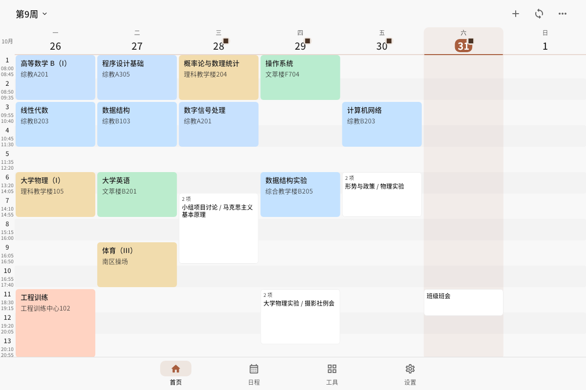

1. 在 **设置 → 登录学校账号** 完成登录。
2. 在首页点同步按钮，选择 **同步全部**。只同步课表时，选择 **自定义同步 → 课表**。
3. 点顶部的 **第 N 周** 选择周次，或左右滑动切换上一周和下一周。
4. 点课程查看详情，再点 **编辑课程** 修改时间、教室和周次。
5. 点首页右上角的 **+ → 添加课程** 手动新建课程。点 **更多 → 周数管理** 调整学期周数，点 **更多 → 导出 ICS** 保存日历文件。

</details>

### 日程、DDL 与考试

把 DDL、活动、课程考试放在同一条时间轴上。可以按类型筛选、切换列表或时间轴，并标记完成。DDL 来源包括乐学、新延河课堂、中国大学 MOOC 和大物实验。

<details>
<summary>查看截图与操作</summary>

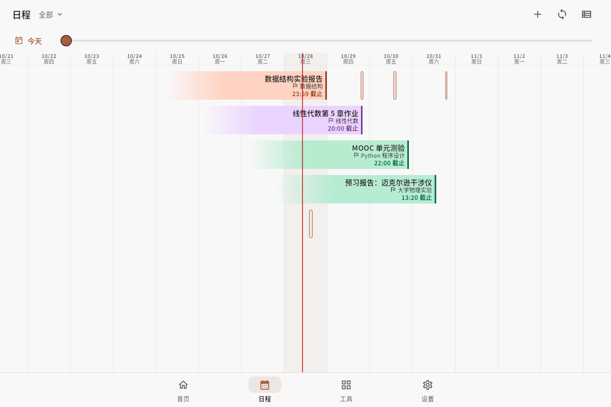

1. 打开 **日程**，用标题旁的筛选菜单选择 **全部 / DDL / 日程 / 考试**。
2. 切换 **未完成** 和 **已完成**，查看对应条目。
3. 点右上角的视图按钮，在 **列表** 和 **时间轴** 之间切换。时间轴可以拖动浏览，也可以缩放时间刻度。
4. 点条目查看详情。DDL 详情里的 **打开作业** 会前往对应平台；编辑、完成和删除也在详情中操作。
5. 同步学校或 MOOC 的 DDL 时，在首页或日程页点同步按钮，选择 **自定义同步**，再勾选需要的来源。

</details>

### 中国大学 MOOC

把 MOOC 作业、测验、考试和互评截止时间同步到日程。MOOC 账号与学校账号分别登录。

<details>
<summary>查看截图与操作</summary>

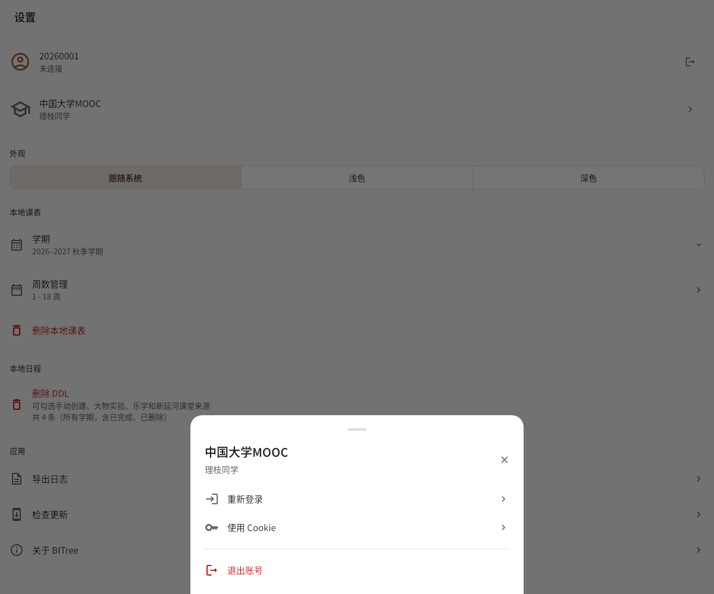

1. 打开 **设置 → 中国大学 MOOC**。
2. 点 **网页登录**，在官方登录页完成登录，然后返回应用。
3. 在首页或日程页点同步按钮，选择 **自定义同步 → 中国大学 MOOC DDL**。
4. 同步完成后，在 **日程** 中查看截止时间、课程和任务详情。
5. 需要时也可以在账号页选择 **使用 Cookie** 连接账号。

</details>

### 空教室查询

按校区、日期和空闲时段查询没有排课的教室，也可以只看某栋教学楼。

<details>
<summary>查看截图与操作</summary>

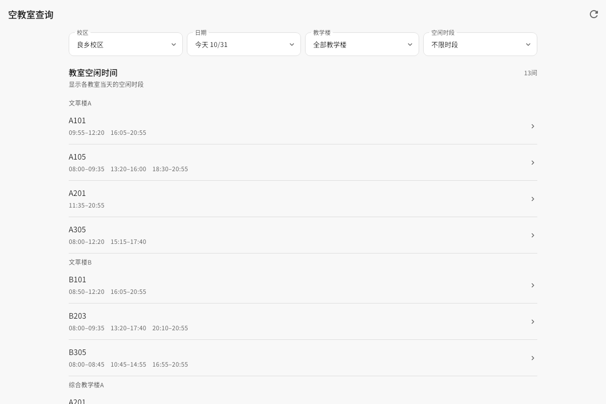

1. 打开 **工具 → 空教室查询**。
2. 选择校区、日期和教学楼。
3. 点 **空闲时段** 选择上课节次。不选时会显示各教室当天的空闲时间。
4. 点教室查看每个时段的 **空闲 / 有课** 状态。文萃楼的教室还可以直接打开 **文萃地图**。
5. 数据有变化时，点右上角的刷新按钮重新查询。

</details>

### 文萃导航

在离线楼层图上查找文萃楼教室，并查看楼梯、电梯、卫生间和一层入口。也可以从课表里的教室直接跳转。

<details>
<summary>查看截图与操作</summary>

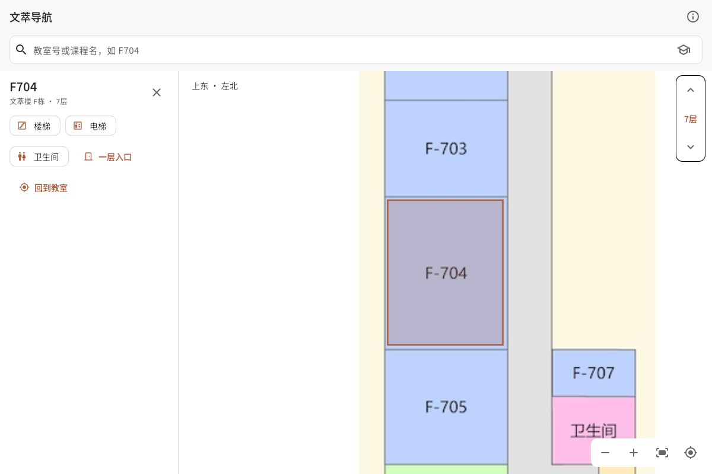

1. 打开 **工具 → 文萃导航**。
2. 搜索教室号或课程名，也可以直接点楼栋。
3. 用楼层按钮或左侧楼层菜单切换 1–10 层，点房间查看位置。
4. 打开 **楼梯 / 电梯 / 卫生间** 筛选，在地图上查看对应设施。
5. 点 **我的文萃课程** 可以按课表快速定位教室。

地图来自学校文萃导航的公开存档，通道开放情况以现场为准。

</details>

### 成绩与学业

同步所有学期的成绩，查看平均绩点、加权平均分、已获学分和学期表现。

<details>
<summary>查看截图与操作</summary>

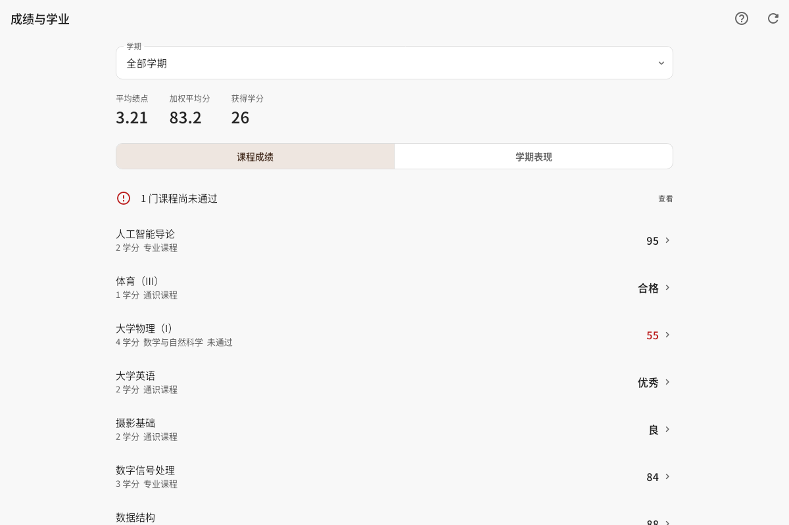

1. 打开 **工具 → 成绩与学业**。
2. 点右上角的刷新按钮同步成绩，或在首页的 **自定义同步** 中勾选 **成绩**。
3. 用 **学期** 菜单筛选学期，在 **课程成绩** 和 **学期表现** 之间切换。
4. 点课程查看成绩、学分、属性和计分分类。未通过的课程会单独提醒。
5. 点右上角的问号查看计分规则。绩点按学分加权，同一课程取最高成绩，规则采用学校公布的[本科生绩点计算方法](https://soe.bit.edu.cn/rcpy/bk/ffa622a7030b45bdadf33415bdffa364.htm)。

</details>

### 成绩试算

用预计成绩试算累计绩点，或输入目标绩点，倒推每门课大致需要达到的分数。

<details>
<summary>查看截图与操作</summary>

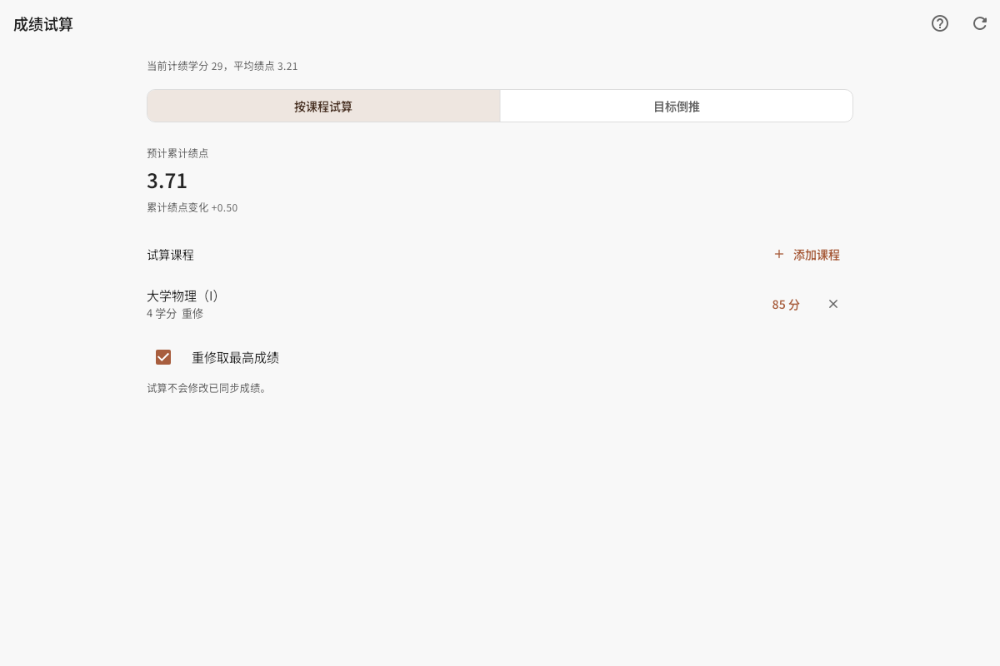

1. 打开 **工具 → 成绩试算**。
2. 选择 **按课程试算**，点 **添加课程**。可以从已同步课程中选择，也可以手动填写课程名称、学分和预计成绩。
3. 添加课程后查看预计累计绩点和绩点变化。
4. 选择 **目标倒推**，输入 0–4 之间的目标累计绩点，查看需要达到的分数。
5. 重修试算时勾选 **重修取最高成绩**。试算只更新页面预览，已同步成绩保持不变。

</details>

### 毕业学分进度

汇总已同步成绩中的学分，按课程类别显示毕业要求、已修学分和尚缺学分。

<details>
<summary>查看截图与操作</summary>

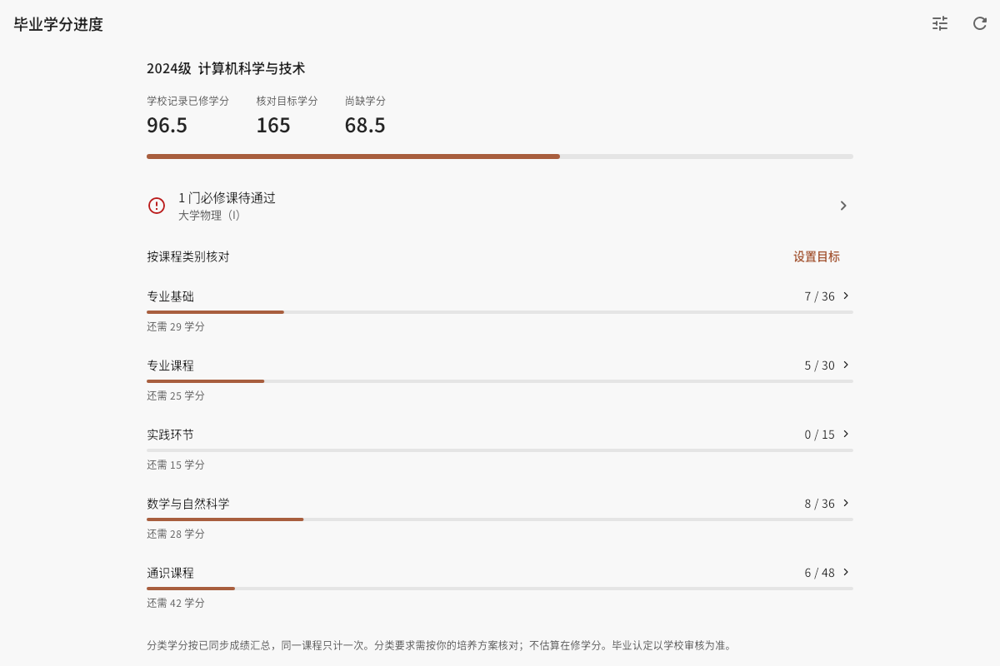

1. 打开 **工具 → 毕业学分进度**。
2. 点右上角的刷新按钮同步学校学分记录，或先同步成绩。
3. 点右上角的调节按钮或 **设置目标**，填写总学分和各类课程目标。
4. 点课程类别查看明细。在课程详情中可以调整 **学分核对分类**。
5. 核对培养方案时，以学校的课程分类和毕业审核结果为准。

</details>

### 考试安排与冲突检查

集中查看考试，并检查考试之间、考试与已保存课表之间的时间重叠。

<details>
<summary>查看截图与操作</summary>

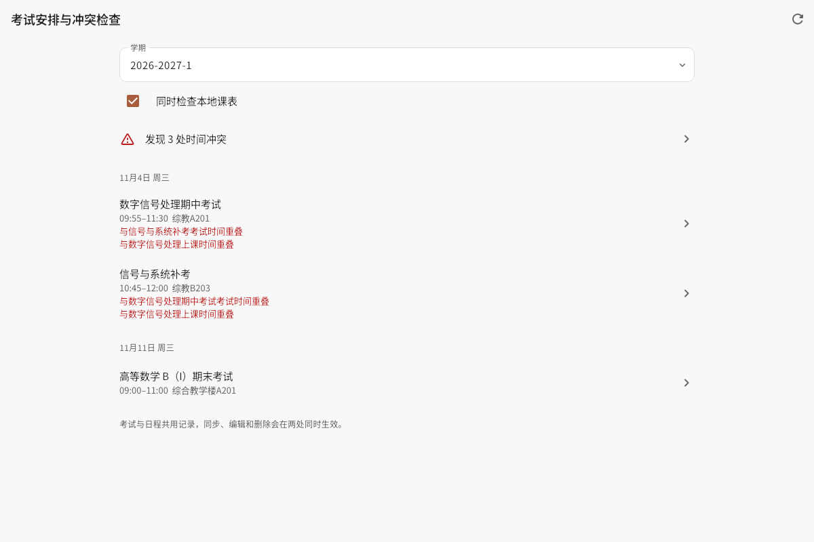

1. 打开 **工具 → 考试安排与冲突检查**。
2. 点右上角的刷新按钮同步考试安排，或用 **自定义同步 → 考试安排**。
3. 选择学期，勾选 **同时检查本地课表**。
4. 发现冲突时，点 **发现 N 处时间冲突** 查看重叠的考试或课程。
5. 点 **查看已结束考试** 可以查看历史记录。考试与日程共用记录，编辑和删除会同时更新两处。

</details>

### Android 桌面日程表

在 Android 桌面查看当天的课程、DDL、活动和考试，提供单列和双列两种布局。

<details>
<summary>查看截图与操作</summary>

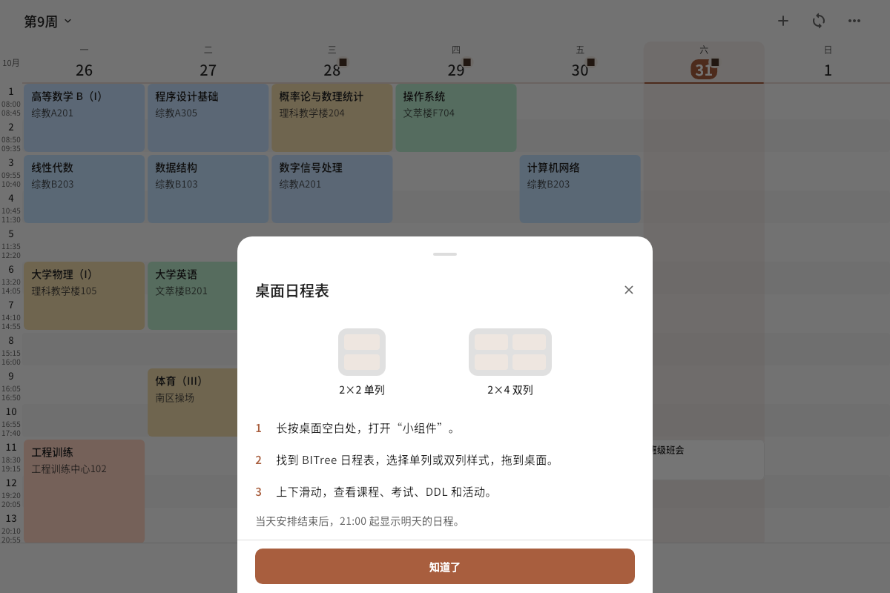

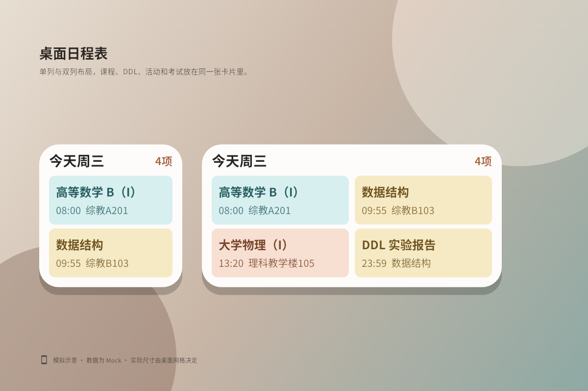

1. 在首页点 **更多 → 桌面日程表**，查看尺寸和使用说明。
2. 长按桌面空白处，打开 **小组件**。
3. 找到 **BITree 日程表**，选择 **2×2 单列** 或 **2×4 双列**，拖到桌面。
4. 在小组件内上下滑动，查看课程、考试、DDL 和活动。
5. 当天安排结束后，小组件从 21:00 起显示明天的日程。

第二张图是小组件布局示意，实际尺寸由桌面网格决定。

</details>

## 下载

前往 [正式版](https://github.com/bitoolkit/bitree/releases/latest) 或 [测试版](https://github.com/bitoolkit/bitree/releases?q=prerelease%3Atrue)，按平台选择文件：

| 平台 | 下载文件 |
| --- | --- |
| Android | arm64-v8a APK |
| Windows | x64 EXE 安装包，包含运行依赖 |
| macOS | 通用版 ZIP，解压后使用，未签名 |
| Linux | x64 / aarch64（arm64）tar.xz，解压后运行 `bitree` |
| iOS | arm64 IPA，需自行签名后安装 |

Linux 的 MOOC 网页登录需要 WebKitGTK 4.1。Debian / Ubuntu 可以安装 `libwebkit2gtk-4.1-0`。Windows 使用系统的 WebView2。

## 数据与隐私

- 课表、日程和学业数据保存在本机。账号凭据和登录会话保存在系统安全存储中。
- 学校与 MOOC 请求从设备直接发往对应平台。
- 日志在本地保留七天。遇到问题时，可在 **设置 → 导出日志** 中查看最近 100 行或导出日志文件。
- 退出学校账号会移除本机登录信息，本地课表和日程继续保留。

## 常见问题

<details>
<summary>登录后看不到课表或成绩</summary>

回到首页，点右上角的同步按钮，选择 **同步全部**。也可以在 **自定义同步** 中只勾选 **课表**、**成绩** 或 **学分进度**。同步完成后，相应页面会自动更新。

</details>

<details>
<summary>学校要求短信或图形验证</summary>

按提示完成验证。如果暂时取消，可以在 **设置** 的学校账号旁点 **验证**，再次进入学校认证页。

</details>

<details>
<summary>如何批量删除已经同步的 DDL</summary>

打开 **设置 → 删除 DDL**，勾选要清理的来源。删除后，可以在首页或日程页的同步菜单中打开 **已删除的 DDL**，逐条恢复或全部恢复。

</details>

## 开发

代码结构、数据流和验证命令见[代码结构与数据流](docs/architecture.md)。

先安装依赖，再生成 README 截图：

```sh
flutter pub get
flutter test --no-pub tool/readme_screenshots_test.dart
```

若系统找不到中文字体，可以指定字体文件：

```sh
BITREE_SCREENSHOT_FONT=/path/to/NotoSansCJK.otf \
  flutter test --no-pub tool/readme_screenshots_test.dart
```

发布构建与错误堆栈还原见[发布与错误堆栈](docs/release.md)。

## LICENSE

[Unlicense](LICENSE). Made by [BIToolkit](https://github.com/bitoolkit) with ♥️
