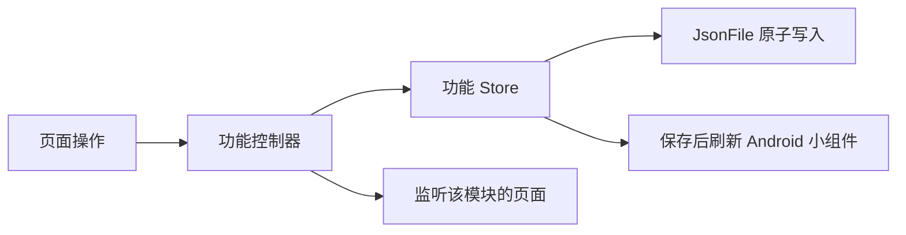

# 代码结构与数据流

各功能放在同名目录：`schedule`、`agenda`、`academics`、`classrooms`、`school`、`wencui` 和 `updates`。功能的页面与表单位于各自的 `ui/`；跨功能控件、主题和动效位于 `lib/ui/`。通用异步、文件和平台访问位于 `lib/core/`。

`main.dart` 创建依赖。`AppController` 负责组合模块、启动和外观设置。各功能控制器拥有自己的状态，页面通过 Flutter 的 `ListenableBuilder` 监听所需模块；功能更新不会经过根控制器转发给整个应用。

## 保存和同步

课表由 `TimetableController` 管理，日程由 `AgendaController` 管理，学业数据由 `AcademicController` 管理。页面提交操作，控制器先保存，再发布新状态；存储失败时保留原状态。学业读取使用 `LatestRequest`，切换账号后，旧读取不会覆盖新账号的数据。



`SchoolController` 负责登录状态、同步操作、请求繁忙状态和错误反馈。成功获取课表、DDL、考试或成绩后，交给相应功能控制器合并并保存。

`SchoolAccess` 负责认证流程。每次操作由 `SchoolConnection` 并行探测服务的校内直连和 WebVPN 入口，使用先连通的一条，并关闭另一条探测连接。探测不带 Cookie、不跟随重定向，也不执行登录或业务操作；单条探测最多等待 8 秒。选定通道出现连接故障时，至多通过另一条通道重新执行一次，不重试账号密码错误或数据解析错误。登录端点连接失败时，也会尝试另一通道，因为它可能已有有效会话。

每次操作重新选路，不沿用上一次的通道；取消操作会关闭探测和业务连接。日志记录所选通道和目标端点。`SchoolSession` 负责 HTTP、Cookie 与响应读取。乐学和新延河课堂仅使用可校外访问的直连入口。

数据仍使用 `schedule.json`、`agenda.json`、`academics.json` 和原有 JSON 字段；凭据与 Cookie 仍使用原有系统安全存储。DDL 同步保留本地编辑、删除标记和已完成状态，并接收平台完成状态。恢复已删除 DDL 是独立操作。

## 空教室查询

页面只负责显示控件、日期选择和登录验证界面。`ClassroomController` 管理查询输入、结果和取消：更换校区或日期会取消旧查询，等待其资源结束后执行新查询；教学楼和时段筛选直接复用已获取的数据。

`ClassroomRepository` 持有教室数据缓存。同账号的教学楼目录缓存一天，占用情况缓存五分钟；相同查询共享进行中的请求。切换账号或退出登录会清空缓存，刷新目录也会清空占用缓存。取消或失败的结果不会缓存。

## 手势与布局

- `SwipePager` 统一鼠标与触摸分页，拖过半页即报告新页，程序切页不报告中间页。
- `SwipeActionTile` 使用原生 `Dismissible` 处理手势和滑出；保存失败回到原位。行的增删尺寸动画由 `AnimatedSliverChildren` 统一处理。
- `PullToRevealList` 管理下拉手势和展开状态，`RevealScrollController` 在布局阶段同步内容高度与滚动位置。用户重新拖动时解除滚动保持，直接接管滚动。
- `AppMenuAnchor` 使用原生 `RawMenuAnchor` 管理焦点与菜单生命周期，统一面板的开合动效。菜单高度取触发器上下的实际可用空间。
- `SheetLayout`、`EditorSheet` 和主题共同约束弹层尺寸、固定操作区与可滚动内容。地图的缩放、绘制和命中测试由 `WencuiFloorMap` 管理。

## 验证

`test/support/test_app.dart` 使用真实功能控制器，只将存储和平台边界替换为内存实现。测试覆盖菜单、滑动、展开与收回、不同窗口和字体大小、请求取消、同步合并、账号切换以及真实文件存储格式。

```sh
dart format lib test
flutter analyze --no-pub
flutter test --no-pub
```

架构划分参考 [Flutter 官方建议](https://docs.flutter.dev/app-architecture/recommendations)、[Compass 的数据层](https://github.com/flutter/samples/tree/main/compass_app/app/lib/data) 和 [Wonderous 的功能状态组织](https://github.com/gskinnerTeam/flutter-wonderous-app/tree/main/lib/logic)，具体边界按本项目的离线存储和学校登录流程确定。
