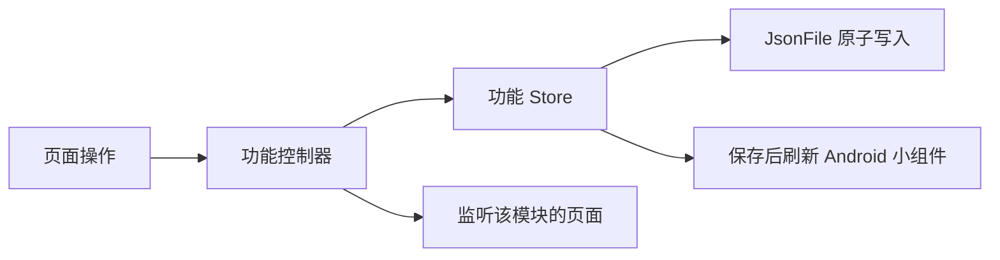

# 代码结构与数据流

各功能放在同名目录：`schedule`、`agenda`、`academics`、`classrooms`、`school`、`wencui` 和 `updates`。功能的页面与表单位于各自的 `ui/`；跨功能控件、主题和动效位于 `lib/ui/`。通用异步、文件和平台访问位于 `lib/core/`。

`main.dart` 创建依赖。`AppController` 负责组合模块、启动和外观设置。各功能控制器拥有自己的状态，页面通过 Flutter 的 `ListenableBuilder` 监听所需模块；功能更新不会经过根控制器转发给整个应用。

## 保存和同步

课表由 `TimetableController` 管理，日程由 `AgendaController` 管理，学业数据由 `AcademicController` 管理。页面提交操作，控制器先保存，再发布新状态；存储失败时保留原状态。学业读取使用 `LatestRequest`，切换账号后，旧读取不会覆盖新账号的数据。



`SchoolController` 负责登录状态、同步操作、请求繁忙状态和错误反馈。成功获取课表、DDL、考试或成绩后，交给相应功能控制器合并并保存。

`SchoolAccess` 负责认证流程。每次操作由 `SchoolConnection` 并行探测服务的校内直连和 WebVPN 入口，使用先连通的一条，并关闭另一条探测连接。探测不带 Cookie、不跟随重定向，也不执行登录或业务操作；单条探测最多等待 8 秒。选定通道出现连接故障时，至多通过另一条通道重新执行一次，不重试账号密码错误或数据解析错误。登录端点连接失败时，也会尝试另一通道，因为它可能已有有效会话。

每次操作重新选路，不沿用上一次的通道；取消操作会关闭探测和业务连接。日志记录并行探测、胜出通道、连接失败后的切换及目标端点，区分探测选中与失败后重试。`SchoolSession` 负责 HTTP、Cookie 与响应读取。乐学和新延河课堂仅使用可校外访问的直连入口。

`SchoolLogin` 在每个认证页面识别当前步骤：已有统一身份认证会话可能直接要求短信验证，也可能在提交密码后跳转到验证页。两个阶段共用短信验证处理，不读取短信页中不存在的密码密钥。`openService` 从服务入口跟随学校的实际登录跳转，供乐学和新延河课堂 DDL 同步共用，不假设每次跳转都带有 `service` 参数。学校业务读取与 DDL 读取在会话过期时各恢复登录并重试一次，再次过期或用户取消时结束操作。

数据仍使用 `schedule.json`、`agenda.json`、`academics.json` 和原有 JSON 字段；凭据与 Cookie 仍使用原有系统安全存储。DDL 同步保留本地编辑、删除标记和已完成状态，并接收平台完成状态。恢复已删除 DDL 是独立操作。

日程导入菜单保留乐学、新延河课堂与大物实验三个独立更新入口；平台更新只请求所选来源，登录与验证也绑定该来源。`SchoolController.importDeadlines` 的可选 `source` 用于单来源请求，省略时仍支持依次处理全部平台，并保留逐平台错误处理、取消和登录状态修复。菜单在学校网络忙碌时仍可打开，远端操作单独禁用；大物实验等本地操作只受本地数据加载和保存状态限制。

## 大物实验 DDL 与分类清空

「更新大物实验 DDL」仅保留在日程页右上角导入菜单中，设置页不提供更新入口。这是手动离线操作，与两个平台 DDL 导入使用同一旗帜图标；点击后直接更新，不再弹出确认页，保留操作结果通知。不触发学校登录，也不会在每次课表同步后自动执行。生成器 `agenda/physics_lab_deadlines.dart` 遍历当前选中学期中有效周数内的每次课程：地点 `room` 同时包含「物理」和「实验」才匹配，缺少星期、节次或周次的课程跳过。课程名称去除首尾空白后按空白拆分，第一段记为 A，两种标题分别为「预习报告 A」和「实验报告 A」。

每次匹配的课程生成两项：预习报告截止于课程起始节次的开始时间；实验报告截止于课日加六天的 23:59，即下周同一星期的前夜。日期沿用校园时间的 UTC 墙上时钟约定。ID 由学期、课程 ID、上课日期和报告类型组成，重复更新不会叠加同一条记录。自动生成项 `source=null, local=false`，用户编辑后沿用编辑器的 `local=true` 保护机制；更新保留本地编辑、完成和删除状态，保留已完成历史与删除标记，仅移除当前学期不再匹配、且没有编辑/完成/删除状态的旧生成项。

设置页仅保留一个「删除 DDL」入口，弹窗通过复选框分别选择手动创建、大物实验、乐学和新延河课堂四个互斥来源，也可全选。手动创建按 `source==null` 且不是实验生成 ID 判定；大物实验按 `isPhysicsLabDeadline` 判定，编辑后仍保留其来源分类。分类不依赖表示编辑保护的 `local` 标志。

弹窗默认不选中任何来源，显示各来源和合计数量，包含所有学期、已完成与已删除记录，删除前明确提示不可撤销，不影响活动和考试。最终点击提交时校验所显示的条目 ID 集合是否仍一致；多选来源在一次写入中删除，避免分组删除造成部分成功。清空后相应平台可再次同步，课表生成项可在日程页再次手动生成。所有修改仍由 `AgendaController` 先写入同一份 `agenda.json`，成功后再通知界面和小组件。

## 日程视图

日程页提供列表与横向多泳道时间轴，共用类型筛选，读取同一个 `AgendaController`，不混入课表课程。列表保留未完成／已完成分页；时间轴将两种状态同表排布，不按完成状态分配泳道，已完成或已结束条目仍沿用弱化样式。视图模式通过 `SharedPreferencesAsync` 的 `agendaViewMode` 保存，缺省为瀑布图（时间轴），已有有效偏好仍按用户选择恢复；缩放和浏览位置不写入日程文件。切换视图保留本次浏览位置，离开日程页后再进入会将时间轴定位到今日 12:00 居中。

`agenda/timeline_layout.dart` 负责纯时间区间与泳道分配：普通日程采用真实起止时间；DDL 始终按 `[dueAt - 4 天, dueAt]` 分配泳道。布局不接收缩放、像素宽度或像素间距，所以缩放、平移和调整窗口大小不会改变泳道。四天不是 DDL 的真实持续时长，也不会保存到模型。

DDL 绘制与布局分离：右端为 `dueAt`，左侧渐隐，屏幕宽度为当前窗口最小缩放时的 3.75 天，即 `cellWidth × 3.75`（180～315 逻辑像素）。该宽度不随缩放变化，窗口变化时可更新；可见条始终包含在四天布局区间内。按实际绘制宽度裁剪条目，短条目的扩展点击区域不会越过同泳道下一条目的布局起点。全天 DDL 的右端沿用模型定义，为对应日期次日零点。

时间轴以视口中心时间和连续缩放比例计算坐标，不创建覆盖历史与未来的巨大滚动画布。默认一天一格，最多一小时一格；基准格宽为 48～84 逻辑像素。平移没有预设日期边界，只绘制可见区域附近的网格和条目。顶部工具栏只保留单行并排的「今天」按钮与自适应宽度的缩放滑条，不显示当前日期和常驻的「时间/格」文本，缩放比例仅保留无障碍语义描述。表头基准高度为 24 逻辑像素：不显示小时时，第一行显示日期、第二行居中显示星期；显示小时时，第一行将「日期 星期」作为一个整体居中，第二行显示小时。标签宽度测量包含完整星期与中间空格，固定在对应时间格的中上方，以完整文字绘制并在视口边缘自然裁切，不贴靠屏幕边缘或变成省略号。首个日程条距表头分隔线 12 逻辑像素，与日程条之间的轨道间距一致。工具栏不再包含问号帮助图标及其提示。当前时间线单独在前景绘制，覆盖日程条但不拦截交互，也不绘制圆点。条目单击复用日程详情弹层，编辑、删除、同步后由功能控制器通知刷新。

仅在时间轴中，考试使用橙色，乐学 DDL 使用黄绿色（工程训练中心调色板），新延河课堂 DDL 使用青绿色，大物实验 DDL 使用紫色。颜色直接引用现有楼宇调色板对应的浅色／深色 `fill`、`text`、`accent`：背景使用 fill、文字使用 text、DDL 右侧条与其他日程边框使用 accent。未完成且逾期的 DDL 优先使用主题的 errorContainer／onErrorContainer／error，不再保留来源色。已完成 DDL 和已结束考试的背景、文字、图标及边框／右侧条统一使用 50% 不透明度（50% 透明），保留各自原色；普通活动的完成样式不变。列表和课表不使用此来源映射。

操作方式：拖动或普通滚轮横向浏览时间，双指捏合、`Ctrl + 滚轮` 或滑条连续缩放；上下拖动或 `Shift + 滚轮` 浏览泳道。时间轴隐藏显式与桌面自动添加的纵向滚动条，仍保留纵向滚动和惯性。单指或鼠标拖动释放后，使用 Flutter 的摩擦物理模拟继续滑行；缩放、新输入、隐藏视图或离开页面时停止惯性，触控板自身的惯性输入不额外叠加甩动。「今天」按钮回到今日居中。时间轴不包在完成状态的 `SwipePager` 内，避免横向时间导航触发状态切页。

## 空教室查询

页面只负责显示控件、日期选择和登录验证界面。`ClassroomController` 管理查询输入、结果和取消：更换校区或日期会取消旧查询，等待其资源结束后执行新查询；教学楼和时段筛选直接复用已获取的数据。

`ClassroomRepository` 持有教室数据缓存。同账号的教学楼目录缓存一天，占用情况缓存五分钟；相同查询共享进行中的请求。切换账号或退出登录会清空缓存，刷新目录也会清空占用缓存。取消或失败的结果不会缓存。

## 手势与布局

- `SwipePager` 统一鼠标与触摸分页，拖过半页即报告新页，程序切页不报告中间页。
- `SwipeActionTile` 使用原生 `Dismissible` 处理手势和滑出；保存失败回到原位。行的增删尺寸动画由 `AnimatedSliverChildren` 统一处理。
- `PullToRevealList` 管理下拉手势和展开状态，`RevealScrollController` 在布局阶段同步内容高度与滚动位置。用户重新拖动时解除滚动保持，直接接管滚动。
- `AppMenuAnchor` 使用原生 `RawMenuAnchor` 管理焦点与菜单生命周期，统一面板的开合动效。菜单高度取触发器上下的实际可用空间。
- `SheetLayout`、`EditorSheet` 和主题共同约束弹层尺寸、固定操作区与可滚动内容。地图的缩放、绘制和命中测试由 `WencuiFloorMap` 管理。

## 验证

`test/support/test_app.dart` 使用真实功能控制器，只将存储和平台边界替换为内存实现。测试覆盖菜单、滑动、展开与收回、不同窗口和字体大小、请求取消、同步合并、账号切换以及真实文件存储格式。

```sh
dart format lib test
flutter analyze --no-pub
flutter test --no-pub
```

架构划分参考 [Flutter 官方建议](https://docs.flutter.dev/app-architecture/recommendations)、[Compass 的数据层](https://github.com/flutter/samples/tree/main/compass_app/app/lib/data) 和 [Wonderous 的功能状态组织](https://github.com/gskinnerTeam/flutter-wonderous-app/tree/main/lib/logic)，具体边界按本项目的离线存储和学校登录流程确定。
