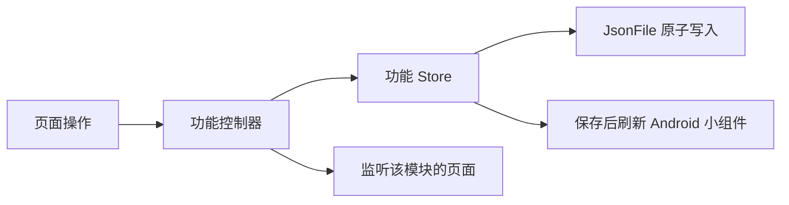

# 代码结构与数据流

各功能放在同名目录：`schedule`、`agenda`、`academics`、`classrooms`、`school`、`mooc`、`sync`、`wencui` 和 `updates`。功能的页面与表单位于各自的 `ui/`；跨功能控件、主题和动效位于 `lib/ui/`。通用异步、文件和平台访问位于 `lib/core/`。

`main.dart` 创建依赖。`AppController` 负责组合模块、启动和外观设置。各功能控制器拥有自己的状态，页面通过 Flutter 的 `ListenableBuilder` 监听所需模块；功能更新不会经过根控制器转发给整个应用。

## 国际化

界面文案由 Flutter gen-l10n 管理。`l10n.yaml` 以 `lib/l10n/app_en.arb` 为模板，与 `app_zh.arb` 一并生成 `app_localizations*.dart`；新增或修改文案后运行 `flutter gen-l10n`。页面通过 `context.l10n` 读取文案，不在控件中直接写用户可见字符串。仅用于解析学校数据、匹配楼栋名称或写入既有 JSON 的来源值保留原格式，显示时再交给本地化 helper。

`lib/l10n/formats.dart` 集中处理日期、星期、周次、节次、学分及来源枚举的显示，保证课表、日程、空教室、学业和文萃地图使用同一套单位与语序。只用于组件测试、且没有 `Localizations` delegate 的页面回退到中文，完整应用始终使用 `AppLocalizations.localizationsDelegates`。

`AppLanguage` 支持跟随系统、简体中文和 English。设置在 `SharedPreferencesAsync` 的 `language` 键中保存 `system`、`chinese` 或 `english`，启动时恢复，切换后立即重建 `MaterialApp` 文案；未保存偏好时使用系统语言，系统语言不是中文时使用英语。

## 保存和同步

课表由 `TimetableController` 管理，日程由 `AgendaController` 管理，学业数据由 `AcademicController` 管理。页面提交操作，控制器先保存，再发布新状态；存储失败时保留原状态。学业读取使用 `LatestRequest`，切换账号后，旧读取不会覆盖新账号的数据。



`SchoolController` 负责登录状态、同步操作、请求繁忙状态和错误反馈。成功获取课表、DDL、考试或成绩后，交给相应功能控制器合并并保存。

`sync/SyncController` 只持有一轮同步的所选内容、进行状态和结果，不提供任务队列、逐项追加或任务历史。覆盖课表、考试安排、成绩、学分进度及乐学、新延河课堂、MOOC、大物实验 DDL。共享学校会话的读取顺序执行，MOOC 独立并行；开始前等待其他学校查询结束，取消等待不会中断那次查询。大物实验 DDL 在本轮课表读取结束后生成。日程导入在 `AgendaController` 内顺序合并，基于最新已保存数据构造结果，并在真正写入前再次检查请求是否已取消，避免并行平台互相覆盖或取消后写入等待中的结果。

首页和日程页共用 `SyncButton`，菜单只有「同步全部」和「自定义同步」。「同步全部」默认覆盖可用来源，跳过尚未登录的 MOOC；自定义抽屉按课表与学业、DDL 两组勾选，主动勾选 MOOC 时可登录。同步静默开始，按钮显示加载状态，再次点击才展开「同步进度」。该抽屉只显示本轮进度、各项结果、整轮取消和重试未完成内容；重试保留本轮指定的学期，返回、收起和下滑关闭不会取消。完成或失败统一反馈一次，抽屉已展开时直接更新列表，不叠加通知遮住操作。

启动时只恢复学校登录，不同步业务数据。恢复登录和后台同步不提供交互验证回调；遇到短信或图形验证时，在获取手机号、验证码图片或发送短信前停止相关读取，并保留「需要短信验证／需要图形验证」账号状态，独立平台继续同步。用户主动重试未完成的内容或查询时可完成验证码验证；取消验证则保留同一待验证状态。

设置中的账号项显示该状态，点击「验证」后重新访问统一认证入口，即使教学中心原有 Cookie 仍有效也可触发验证。取消或连接失败时保留待验证状态，成功后恢复「已登录」；凭据失效时转为「需要重新登录」。这次检查只更新登录会话，不写入课表、日程或学业数据，不自动重放先前取消的同步操作。

`SchoolAccess` 负责认证流程。每次操作由 `SchoolConnection` 并行探测服务的校内直连和 WebVPN 入口，使用先连通的一条，并关闭另一条探测连接。探测不带 Cookie、不跟随重定向，也不执行登录或业务操作；单条探测最多等待 8 秒。选定通道出现连接故障时，至多通过另一条通道重新执行一次，不重试账号密码错误或数据解析错误。登录端点连接失败时，也会尝试另一通道，因为它可能已有有效会话。

每次操作重新选路，不沿用上一次的通道；取消操作会关闭探测和业务连接。日志记录并行探测、胜出通道、连接失败后的切换及目标端点，区分探测选中与失败后重试。`SchoolSession` 负责 HTTP、Cookie 与响应读取。乐学和新延河课堂仅使用可校外访问的直连入口。

`SchoolLogin` 在每个认证页面识别当前步骤：已有统一身份认证会话可能直接要求短信验证，也可能在提交密码后跳转到验证页。两个阶段共用短信验证处理，不读取短信页中不存在的密码密钥。`openService` 从服务入口跟随学校的实际登录跳转，供乐学和新延河课堂 DDL 同步共用，不假设每次跳转都带有 `service` 参数。学校业务读取与 DDL 读取在会话过期时各恢复登录并重试一次，再次过期或用户取消时结束操作。

USTC 风控采集失败时遵循学校登录页的协议：仅在风控请求出现 HTTP／连接错误，或响应不是有效 token 时，将加密的 `risk_payload` 设为 `{"error":true}`，仍保留 `riskEngine=true` 并由学校继续认证。这不是登录成功状态；密码错误、短信验证、服务回调和登录会话检查照常执行。取消、凭据存储失败和程序错误不进入此处理。采集失败的技术原因只写入日志，不单独弹出内部接口地址。`/gate` 是公开页面配置的前端资源网关，不能直接据此改写独立风控服务地址。

数据仍使用 `schedule.json`、`agenda.json`、`academics.json` 和原有 JSON 字段；凭据与 Cookie 仍使用原有系统安全存储。DDL 同步保留本地编辑、删除标记和已完成状态，并接收平台完成状态。恢复已删除 DDL 是独立操作。

四个 DDL 来源统一在自定义同步中选择，不再占据顶层菜单的四个入口。`SchoolController.importDeadlines` 的可选 `source` 用于所选学校平台，省略时依次处理乐学与新延河课堂，保留逐平台错误处理、取消和登录状态修复。MOOC 使用独立的账号和控制器，不进入学校认证流程。大物实验为本地操作。

## 大物实验 DDL 与分类清空

大物实验 DDL 包含在「同步全部」中，也可通过自定义同步单独选择；单独同步时是本地操作，不触发学校登录。不会在应用启动或只同步课表时自动执行。生成器 `agenda/physics_lab_deadlines.dart` 遍历当前选中学期中有效周数内的每次课程：地点 `room` 同时包含「物理」和「实验」才匹配，缺少星期、节次或周次的课程跳过。课程名称去除首尾空白后按空白拆分，第一段记为 A，两种标题分别为「预习报告 A」和「实验报告 A」。

每次匹配的课程生成两项：预习报告截止于课程起始节次的开始时间；实验报告截止于课日加六天的 23:59，即下周同一星期的前夜。日期沿用校园时间的 UTC 墙上时钟约定。ID 由学期、课程 ID、上课日期和报告类型组成，重复更新不会叠加同一条记录。每次导入统一采样一次校园时间：仅首次导入且截止时间严格早于该时刻的条目自动标为已完成；同 ID 条目已经存在时，无论是否逾期都保留原完成状态，包括已删除记录。自动生成项 `source=null, local=false`，用户编辑后沿用编辑器的 `local=true` 保护机制；更新保留本地编辑、完成和删除状态，保留已完成历史与删除标记，仅移除当前学期不再匹配、且没有编辑/完成/删除状态的旧生成项。

设置页仅保留一个「删除 DDL」入口，弹窗通过复选框分别选择手动创建、大物实验、乐学、新延河课堂和中国大学MOOC 五个互斥来源，也可全选。手动创建按 `source==null` 且不是实验生成 ID 判定；大物实验按 `isPhysicsLabDeadline` 判定，编辑后仍保留其来源分类。分类不依赖表示编辑保护的 `local` 标志。

弹窗默认不选中任何来源，显示各来源和合计数量，包含所有学期、已完成与已删除记录，删除前明确提示不可撤销，不影响活动和考试。最终点击提交时校验所显示的条目 ID 集合是否仍一致；多选来源在一次写入中删除，避免分组删除造成部分成功。清空后相应平台可再次同步，课表生成项可在日程页再次手动生成。所有修改仍由 `AgendaController` 先写入同一份 `agenda.json`，成功后再通知界面和小组件。

## 日程视图

日程页提供列表与横向多泳道时间轴，共用类型筛选，读取同一个 `AgendaController`，不混入课表课程。列表保留未完成／已完成分页；时间轴将两种状态同表排布，不按完成状态分配泳道，已完成或已结束条目仍沿用弱化样式。视图模式通过 `SharedPreferencesAsync` 的 `agendaViewMode` 保存，缺省为瀑布图（时间轴），已有有效偏好仍按用户选择恢复；缩放和浏览位置不写入日程文件。切换视图保留本次浏览位置，离开日程页后再进入会将时间轴定位到今日 12:00 居中。

`agenda/timeline_layout.dart` 负责显示区间与泳道分配：普通日程和考试的条目保留真实起止时间，显示宽度至少为固定 2 逻辑像素，不随字体缩放改变；过窄时不强行显示卡内文字，仍可通过点击详情或悬停／长按预览查看完整信息。界面按当前缩放将最小宽度换算为时间跨度，布局通过 `layoutEnd` 同时约束绘制、可见区域筛选和泳道避让。显示范围相交的条目分入不同泳道，缩放或窗口宽度改变时可重新排布；单纯平移或字体缩放不改变这一最小宽度和横向占位规则。DDL 始终按 `[dueAt - 4 天, dueAt]` 分配泳道，原有渐变宽度不变。两类显示占位都不会修改条目的真实时间或写入模型。

`AgendaTimelineEntry` 只负责条目的外观和交互，不处理坐标或泳道。日程与考试在标题下常驻真实起止时间，跨天时分两行标出日期；全天日程显示日期范围。DDL 保留课程／来源，并另列截止时间。长按或鼠标悬停显示包含开始、结束或截止日期、课程及地点的分行预览；点按沿用详情抽屉。卡片最小高度为 56 逻辑像素，并随字体放大，确保完整时间与来源信息有独立空间。

DDL 绘制与布局分离：右端为 `dueAt`，左侧渐隐，屏幕宽度为当前窗口最小缩放时的 3.75 天，即 `cellWidth × 3.75`（180～315 逻辑像素）。该宽度不随缩放变化，窗口变化时可更新；可见条始终包含在四天布局区间内。按实际绘制宽度裁剪条目，短条目的扩展点击区域不会越过同泳道下一条目的布局起点。全天 DDL 的右端沿用模型定义，为对应日期次日零点。

时间轴以视口中心时间和连续缩放比例计算坐标，不创建覆盖历史与未来的巨大滚动画布。默认一天一格，最多一小时一格；基准格宽为 48～84 逻辑像素。平移没有预设日期边界，只绘制可见区域附近的网格和条目。顶部工具栏只保留单行并排的「今天」按钮与自适应宽度的缩放滑条，不显示当前日期和常驻的「时间/格」文本，缩放比例仅保留无障碍语义描述。表头基准高度为 24 逻辑像素：不显示小时时，第一行显示日期、第二行居中显示星期；显示小时时，第一行将「日期 星期」作为一个整体居中，第二行显示小时。标签宽度测量包含完整星期与中间空格，固定在对应时间格的中上方，以完整文字绘制并在视口边缘自然裁切，不贴靠屏幕边缘或变成省略号。首个日程条距表头分隔线 12 逻辑像素，与日程条之间的轨道间距一致。工具栏不再包含问号帮助图标及其提示。当前时间线单独在前景绘制，覆盖日程条但不拦截交互，也不绘制圆点。条目单击复用日程详情弹层，编辑、删除、同步后由功能控制器通知刷新。

仅在时间轴中，手动创建的 DDL 使用绿色（文萃楼调色板），考试使用橙色，乐学 DDL 使用黄绿色（工程训练中心调色板），新延河课堂 DDL 使用青绿色，大物实验 DDL 使用紫色。颜色直接引用现有楼宇调色板对应的浅色／深色 `fill`、`text`、`accent`：背景使用 fill、文字使用 text、DDL 右侧条与其他日程边框使用 accent。未完成且逾期的 DDL 优先使用主题的 errorContainer／onErrorContainer／error，不再保留来源色。已完成 DDL 和已结束考试的背景、文字、图标及边框／右侧条统一使用 50% 不透明度（50% 透明），保留各自原色；普通活动的完成样式不变。列表和课表不使用此来源映射。

操作方式：拖动或普通滚轮横向浏览时间，双指捏合、`Ctrl + 滚轮` 或滑条连续缩放；上下拖动或 `Shift + 滚轮` 浏览泳道。时间轴隐藏显式与桌面自动添加的纵向滚动条，仍保留纵向滚动和惯性。单指或鼠标拖动释放后，使用 Flutter 的摩擦物理模拟继续滑行；缩放、新输入、隐藏视图或离开页面时停止惯性，触控板自身的惯性输入不额外叠加甩动。「今天」按钮回到今日居中。日程列表的完成状态以分段选择过滤，不使用横向分页；时间轴的横拖只用于时间导航。

## 中国大学MOOC

`MoocController` 独立管理 MOOC 账号、当前请求与同步结果。`ui/login.dart` 通过 `webview_all` 在应用页面中内嵌官方登录页。浏览器在 MOOC 来源内读取已登录的 `webUser` 账号字段和真实 User-Agent，原生 Cookie 管理器导出适用于 `/web/j/` 的会话，再交给控制器保存到安全存储。网页的 JavaScript 对象由浏览器执行后转换为普通数据，Dart 不再抓取 HTML 或解析服务端脚本。Cookie 导入先写入同一浏览器，再打开官方个人中心确认账号，复用相同的登录完成流程。只有保存会话时才显示忙碌状态；读取失败停止轮询，用户可刷新或重试，不反复显示验证提示。密码只由官方页面处理。

`MoocApi` 只请求固定 HTTPS 来源的读取接口，不跟随认证重定向。Cookie 的域、路径、到期与服务器轮换由 `cookie_jar` 管理，请求前按路径长度排列同名 Cookie。同步使用保存的会话分页读取 `courseType=1/2` 的全部课程，再通过 `getLastLearnedMocTermDto` 读取包含个人提交记录的课程学期 DTO。`tasks.dart` 区分提交与学生互评截止；有效提交次数、已提交状态或已有得分均可确认提交完成，不等待最终评分，也不把逾期视作完成。互评通过 `getEvaluateStatus` 的 `stepEvaluated` 单独确认；老师批改不会生成互评任务，考试使用主观题编号查询互评。任务编号包含账号、学期、任务类型与阶段，交给 `AgendaController.mergeDeadlines` 更新远端完成状态并保留本地编辑、完成与删除状态。某门课程的结构或互评读取失败时，不导入该课程的部分结果，并显示课程名和原因；接口报告会话过期或请求取消时，不保存任何部分导入结果。应用启动只读本机会话，不自动发起 MOOC 登录或同步。

账号抽屉只处理登录、Cookie 回退与退出。课表、日程和学业页面使用 `sync/ui/sync.dart` 发起同步，MOOC 与学校来源共用本轮进度抽屉；会话过期时通过重试重新登录，取消登录则保留本轮结果。独立的 MOOC 同步弹窗和页面销毁时取消请求的路径已移除。

`MoocCookie` 在浏览器导出、持久化恢复和 HTTP 响应轮换处使用同一转换方式，原样保留浏览器接受的逗号、引号等值，不重新编码会话。名称与属性仍由 Dart 解析，域、路径和过期策略仍由原有 Cookie 管理器执行；值中拒绝控制字符和分号，防止改变请求头或 Cookie 边界。安全存储的字段和格式不变。

接口字段依据官方个人中心的 `home/desktop/modules/course/index.html`、`spocCourse/index.html` 及其脚本，以及公开课程 `courseBean.getMocTermDto.rpc` 的实际响应。登录验证码与风控都由平台官方页面完成。

## 空教室查询

页面只负责显示控件、日期选择和登录验证界面。`ClassroomController` 管理查询输入、结果和取消：更换校区或日期会取消旧查询，等待其资源结束后执行新查询；教学楼和时段筛选直接复用已获取的数据。

`ClassroomRepository` 持有教室数据缓存。同账号的教学楼目录缓存一天，占用情况缓存五分钟；相同查询共享进行中的请求。切换账号或退出登录会清空缓存，刷新目录也会清空占用缓存。取消或失败的结果不会缓存。

## 手势与布局

- `SwipePager` 统一鼠标与触摸分页，拖过半页即报告新页，程序切页不报告中间页。
- `SwipeActionTile` 以明确的横向意图接管单条操作，不增加按住等待。短滑露出按钮，长滑达到阈值后松手执行；左滑完成或恢复 DDL，右滑删除。快速收回和反向拖回都可以取消。`TapRegion` 处理外部触摸收起，最近的纵向 `ScrollPosition` 处理滚动收起，不额外维护全局打开条目。滑出、按钮停靠与回弹共用动画，保存失败回到原位。行的增删尺寸动画由 `AnimatedSliverChildren` 统一处理。
- `PullToRevealList` 管理下拉手势和展开状态，`RevealScrollController` 在布局阶段同步内容高度与滚动位置。用户重新拖动时解除滚动保持，直接接管滚动。
- `AppMenuAnchor` 使用原生 MD3 `MenuAnchor` 管理定位、淡入淡出、焦点和菜单生命周期，仅将动画状态提供给触发器。根菜单从触发器下沿展开，选区菜单按落点定位；关闭横轴无约束布局，让表单宽度和可视区域约束生效。外部点击被消费，避免关闭菜单时误触底层操作；菜单项直接使用 `MenuItemButton`。
- `SheetLayout`、`EditorSheet` 和主题共同约束弹层尺寸、固定操作区与可滚动内容。地图的缩放、绘制和命中测试由 `WencuiFloorMap` 管理。

## 验证

`test/support/test_app.dart` 使用真实功能控制器，只将存储和平台边界替换为内存实现。测试覆盖菜单、滑动、展开与收回、不同窗口和字体大小、请求取消、同步合并、账号切换以及真实文件存储格式。

```sh
dart format lib test
flutter analyze --no-pub
flutter test --no-pub
```

架构划分参考 [Flutter 官方建议](https://docs.flutter.dev/app-architecture/recommendations)、[Compass 的数据层](https://github.com/flutter/samples/tree/main/compass_app/app/lib/data) 和 [Wonderous 的功能状态组织](https://github.com/gskinnerTeam/flutter-wonderous-app/tree/main/lib/logic)，具体边界按本项目的离线存储和学校登录流程确定。
